<div align="center">

# Project CALIDAS

### **CA**mera · **LI**DAR · **D**epth **A**utonomous **S**ystem

Three sensor-driven autonomous driving pipelines, built from scratch in **ROS 2 Jazzy** and **Gazebo Harmonic**:
a camera-guided race car, a LiDAR racer with live SLAM, and a depth-camera explorer that builds 3D maps.


</div>

---

## Highlights

- **Three complete perception → decision → actuation pipelines**, each in a single, readable Python node.
- **Two vehicle kinematics modelled by hand** in URDF/Xacro (no TurtleBot templates): a 4-wheel **Ackermann** car and a 2-wheel **differential-drive** robot.
- **Classical computer vision** (HSV segmentation, connected components, dual-band PD steering) driving a car from a single camera.
- **LiDAR Follow-the-Gap racing** with automatic reverse-and-unstick recovery, mapping the circuit live with **SLAM Toolbox**, plus optional **Nav2** (Hybrid-A\* + Regulated Pure Pursuit) for goal-directed driving.
- **3D mapping with RTAB-Map** from a single rotating RGB-D camera using a stop-and-scan state machine.
- Everything runs **virtually**: no hardware needed. One command per project.

## Table of contents

1. [Projects at a glance](#projects-at-a-glance)
2. [Sub-project 1 — Camera-guided car (OpenCV)](#sub-project-1--camera-guided-car-opencv)
3. [Sub-project 2 — LiDAR racer + SLAM + Nav2](#sub-project-2--lidar-racer--slam--nav2)
4. [Sub-project 3 — Depth-camera explorer + RTAB-Map](#sub-project-3--depth-camera-explorer--rtab-map)
5. [Getting started](#getting-started)
6. [ROS interface](#ros-interface)
7. [Repository structure](#repository-structure)
8. [Known limitations and roadmap](#known-limitations-and-roadmap)
9. [Credits, assets and license](#credits-assets-and-license)

---

## Projects at a glance

| # | Project | Vehicle | Sensor | Autonomy | World | Launch |
|---|---|---|---|---|---|---|
| 1 | **CA** — Camera Ackermann | 4-wheel Ackermann car | Monocular RGB camera, 640×480 @ 10 Hz | OpenCV road segmentation + PD steering (`autonomous_driver.py`) | Flat 40 m × 40 m circuit (`track.sdf`) | `track.launch.py` |
| 2 | **LI** — LiDAR racer | 4-wheel Ackermann car | 360° 2D GPU LiDAR, 0.3–12 m @ 10 Hz | Follow-the-Gap + wall centering (`autonomous_racer.py`), SLAM Toolbox, optional Nav2 | 3D Silverstone circuit (`silverstone.sdf`) | `silverstone.launch.py` |
| 3 | **DAS** — Depth explorer | 2-wheel differential-drive robot ("auto") | Rotating RGB-D camera, 320×240 @ 8 Hz | Stop-and-scan exploration (`auto_explorer.py`) + RTAB-Map | 3D low-poly city (`city.sdf`) | `city.launch.py` |

---

## Sub-project 1 — Camera-guided car (OpenCV)

A car that laps a textured 2D circuit using **only one forward-facing camera**: no lane map, no LiDAR, no odometry feedback in the control law.

<table>
<tr>
<td width="33%"></td>
<td width="33%"></td>
<td width="33%"></td>
</tr>
<tr>
<td align="center"><sub>Raw camera view in RViz2: the car's own nose and front wheels are visible and must be masked out.</sub></td>
<td align="center"><sub>Live HUD on a left bend: <b>1.13 m/s, +12.2° steer</b>.</sub></td>
<td align="center"><sub>Braking into a right hairpin: <b>0.80 m/s, −24.0° steer</b>.</sub></td>
</tr>
</table>

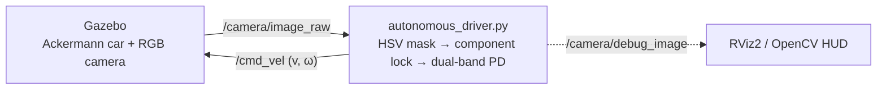

**How it works**

1. **Mask the car itself.** The camera sits on the chassis (`xyz = 0.70 0 0.17`), so the red nose and black front wheels fill part of the image. A static spatial mask keeps only the road ahead (rows 259–332, columns 140–500) plus two small side windows beside the nose for tight hairpins.
2. **Segment the road in HSV.** After a 5×5 Gaussian blur, grey asphalt (S ≤ 58, 32 ≤ V ≤ 170) and white markings (S ≤ 52, V ≥ 170) are kept. Grass and water (H 26–135) and red/orange curbs and nose are subtracted. Morphological close + open clean the mask.
3. **Lock onto the right ribbon of road.** `cv2.connectedComponentsWithStats` (8-connectivity) scores each blob by area, by whether it reaches the near field, and by horizontal continuity with the last tracked road centre, so a parallel track visible across the grass never steals the steering.
4. **Steer with two look-ahead bands.** A *near* band (about 0.8–1.5 m ahead) corrects lane position; a *far* band (about 1.5–4.6 m) anticipates the curve. Image moments give normalised errors, blended by a PD law with an exponential-moving-average filter.
5. **Slow down for corners.** Speed scales from **1.65 m/s** on straights to **0.70 m/s** in hairpins from the steering angle and the near/far disagreement. If the road is lost, an apex-recovery mode keeps steering the same way at 0.55 m/s.
6. **Respect the car's kinematics.** The Ackermann plugin takes a yaw rate, so the node sends `ω = (v / L) · tan(δ)` with `L = 0.76 m`; the front wheels then hold exactly the intended steering angle at every speed.

---

## Sub-project 2 — LiDAR racer + SLAM + Nav2

The same Ackermann car drives the 3D Silverstone circuit using only a **360° 2D LiDAR**, while **SLAM Toolbox** builds a 2D occupancy map of the track as it goes.

<table>
<tr>
<td width="50%"></td>
<td width="50%"></td>
</tr>
<tr>
<td align="center"><sub>First corner, ~11 s into the run: the map has just started to form.</sub></td>
<td align="center"><sub>Under the start/finish gantry, ~119 s of simulation time: the circuit is mapped and the loop is closed.</sub></td>
</tr>
</table>

<div align="center">
<br>
<sub>The 2D map produced by SLAM Toolbox and saved with <code>map_saver_cli</code> (example files: <code>track_save.pgm</code> / <code>track_save.yaml</code>).</sub>
</div>

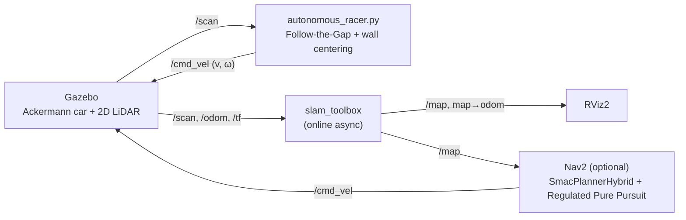

**How the racer works** (`autonomous_racer.py`)

| Step | What happens |
|---|---|
| Clean the scan | NaN → 0 m (self-hit / obstacle); ±inf → 10 m (open track). |
| Read sectors | Front ±18° (20th percentile, robust to single-ray noise), left 25° to 85°, right −85° to −25°. |
| Find the gap | Within ±75°, a safety bubble (±5 rays) is blanked around the closest point, a 9-ray moving average widens the search, and the deepest corridor gives the target angle `θ_gap`. |
| Centre on the walls | `wall_err = (d_left − d_right) / (d_left + d_right)`; steering = `0.65 · θ_gap + 0.45 · wall_err` with derivative damping and EMA smoothing. |
| Pick the speed | **0.75 to 2.00 m/s**, higher with more front clearance and less steering. |
| Recover | An Ackermann car cannot spin on the spot. If the front distance drops below **0.65 m**, it **reverses for 1.2 s at −0.5 m/s with opposite steering lock** so the nose swings toward the open side. |

**Optional Nav2.** `use_nav2:=true` starts Nav2 on the live SLAM map using a planner and controller suited to a car: **SmacPlannerHybrid** (Reeds-Shepp, minimum turning radius 1.40 m) and **Regulated Pure Pursuit** with rotate-to-heading disabled. A differential-drive Nav2 setup cannot be used here because the car cannot turn in place.

---

## Sub-project 3 — Depth-camera explorer + RTAB-Map

A differential-drive robot (the **auto**) explores a low-poly city and builds a **3D point-cloud map** and a **2D occupancy grid** with **RTAB-Map**. To avoid multiple cameras, a **single RGB-D camera sits on a motorised turret** (a continuous joint) and sweeps 360° while the robot is parked.

<table>
<tr>
<td width="33%"></td>
<td width="33%"></td>
<td width="33%"></td>
</tr>
<tr>
<td align="center"><sub>Stage 1: the parked robot sweeps its turret and reconstructs the surroundings.</sub></td>
<td align="center"><sub>After homing the camera and driving one step down an open corridor.</sub></td>
<td align="center"><sub>Successive scans extend the 3D cloud and the 2D map along the street.</sub></td>
</tr>
</table>

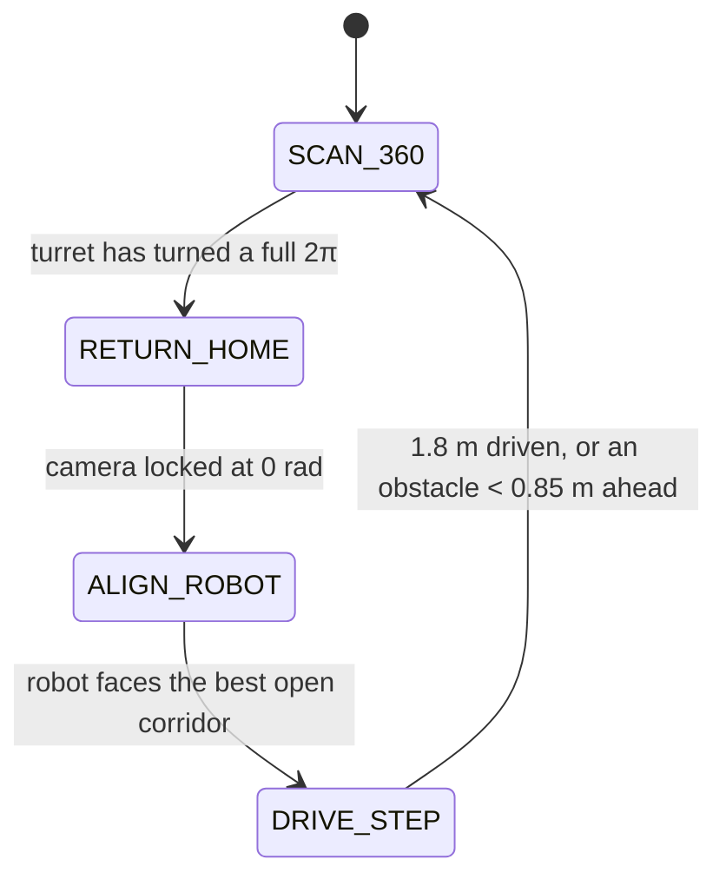

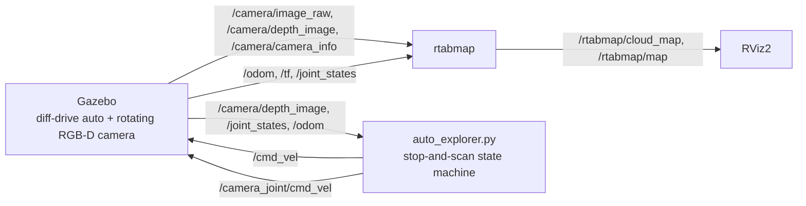

**How it works** (`auto_explorer.py`)

- **Polar obstacle ring.** While the turret sweeps at 1.2 rad/s, each depth frame is binned into **36 sectors of 10°** around the robot. The deepest open sector becomes the next heading, and dead ends trigger a turn-around.
- **Ignore the road surface.** Pixels below the optical horizon hit the pavement a metre or two ahead and look like walls. The node therefore uses only the **horizon band (image rows 22% to 48%)** and discards readings closer than 0.45 m (the robot's own chassis).
- **Map while parked.** RTAB-Map normally waits for the base to move. Because only the turret moves during a scan, it is started with `--RGBD/LinearUpdate 0.0 --RGBD/AngularUpdate 0.0` and `map_always_update:=true`, so keyframes keep being added from the rotating `camera_link` transform.
- **Fresh map each run.** The database is cleared on start (`--delete_db_on_start`) and saved to `~/.ros/rtabmap.db`.

---

## Getting started

### Requirements

- Ubuntu 24.04 or Linux Mint 22
- ROS 2 Jazzy and Gazebo Harmonic

### Install dependencies

```bash
sudo apt update
sudo apt install -y \
  ros-jazzy-ros-gz-sim ros-jazzy-ros-gz-bridge ros-jazzy-ros-gz-image \
  ros-jazzy-slam-toolbox ros-jazzy-navigation2 ros-jazzy-nav2-bringup \
  ros-jazzy-rtabmap-ros ros-jazzy-xacro ros-jazzy-robot-state-publisher \
  ros-jazzy-teleop-twist-keyboard python3-opencv python3-numpy
```

### Build

```bash
git clone https://github.com/balaji-vm-official/Project_CALIDAS.git ~/Documents/Project_CALIDAS
cd ~/Documents/Project_CALIDAS

# The three world files load meshes and a texture by absolute path.
# Point them at wherever you cloned the repository:
sed -i "s|/home/comrade/Documents/Project_CALIDAS|$PWD|g" src/Project_CALIDAS/worlds/*.sdf

chmod +x src/Project_CALIDAS/scripts/*.py
colcon build --symlink-install
source install/setup.bash
```

> Source `install/setup.bash` in every new terminal. After changing files, rebuild with `colcon build --symlink-install`.

### Run

| Project | Command |
|---|---|
| **1. Camera car** | `ros2 launch Project_CALIDAS track.launch.py` |
| **2. LiDAR racer + SLAM** | `ros2 launch Project_CALIDAS silverstone.launch.py` |
| **2. Drive it yourself** | `ros2 launch Project_CALIDAS silverstone.launch.py enable_racer:=false` |
| **2. With Nav2** | `ros2 launch Project_CALIDAS silverstone.launch.py use_nav2:=true enable_racer:=false` |
| **3. Depth explorer + RTAB-Map** | `ros2 launch Project_CALIDAS city.launch.py` |
| **3. Drive it yourself** | `ros2 launch Project_CALIDAS city.launch.py enable_explorer:=false` |

For manual driving, run `ros2 run teleop_twist_keyboard teleop_twist_keyboard` in another terminal. With the car, use **u** / **o** to steer, because an Ackermann car cannot turn without moving forward.

**Save the 2D map** made by SLAM Toolbox (project 2):

```bash
ros2 run nav2_map_server map_saver_cli -f ~/Documents/Project_CALIDAS/silverstone_map
```

**Inspect the 3D map** made by RTAB-Map (project 3), after closing the simulation:

```bash
rtabmap-databaseViewer ~/.ros/rtabmap.db
```

### Tune while running

```bash
# Project 1
ros2 param set /autonomous_track_driver max_speed 1.85
ros2 param set /autonomous_track_driver kp_near 0.55
```

The key parameters of each node are declared at the top of its script:

| Node | Parameters |
|---|---|
| `autonomous_driver.py` | `max_speed` 1.65, `min_speed` 0.70, `kp_near` 0.52, `kp_far` 0.48, `kd_steer` 0.14, `steering_smoothing` 0.65 |
| `autonomous_racer.py` | `max_speed` 2.00, `min_speed` 0.75, `reverse_speed` −0.50, `safety_stop_dist` 0.65, `k_gap` 0.65, `k_wall` 0.45, `kd_steer` 0.10 |
| `auto_explorer.py` | `step_distance` 1.80, `cruise_speed` 0.45, `camera_scan_speed` 1.20, `stop_distance` 0.85, `min_valid_distance` 0.45, `max_depth_range` 8.0 |

---

## ROS interface

| Topic | Type | Direction | Used by |
|---|---|---|---|
| `/clock` | `rosgraph_msgs/Clock` | Gazebo → ROS | all |
| `/cmd_vel` | `geometry_msgs/Twist` | ROS → Gazebo | all |
| `/odom` | `nav_msgs/Odometry` | Gazebo → ROS | all |
| `/tf`, `/tf_static` | `tf2_msgs/TFMessage` | both | all |
| `/joint_states` | `sensor_msgs/JointState` | Gazebo → ROS | all |
| `/camera/image_raw` | `sensor_msgs/Image` | Gazebo → ROS | 1, 3 |
| `/camera/camera_info` | `sensor_msgs/CameraInfo` | Gazebo → ROS | 1, 3 |
| `/camera/debug_image` | `sensor_msgs/Image` | node → RViz | 1 |
| `/scan` | `sensor_msgs/LaserScan` | Gazebo → ROS | 2 |
| `/scan/points` | `sensor_msgs/PointCloud2` | Gazebo → ROS | 2 |
| `/camera/depth_image` | `sensor_msgs/Image` (32FC1) | Gazebo → ROS | 3 |
| `/depth_camera/points` | `sensor_msgs/PointCloud2` | Gazebo → ROS | 3 |
| `/camera_joint/cmd_vel` | `std_msgs/Float64` | ROS → Gazebo | 3 (turret) |
| `/map` | `nav_msgs/OccupancyGrid` | slam_toolbox | 2 |
| `/rtabmap/cloud_map`, `/rtabmap/map` | `PointCloud2`, `OccupancyGrid` | rtabmap | 3 |

The bridge between Gazebo Transport and ROS 2 is defined in [`config/gz_bridge.yaml`](src/Project_CALIDAS/config/gz_bridge.yaml).

**Transform tree:** `map → odom → base_link → (chassis | wheels / steering knuckles | laser_frame | camera_link → camera_link_optical)`. Gazebo's drive plugin publishes `odom → base_link`; `robot_state_publisher` publishes the rest from the URDF; SLAM Toolbox or RTAB-Map publish `map → odom`. Every node runs with `use_sim_time`.

---

## Repository structure

```text
Project_CALIDAS/
├── README.md
├── docs                         screenshots used in this README
├── track_save.pgm / .yaml       example 2D map saved from SLAM Toolbox
└── src/Project_CALIDAS/
    ├── CMakeLists.txt, package.xml
    ├── scripts/
    │   ├── autonomous_driver.py   project 1: OpenCV camera driver
    │   ├── autonomous_racer.py    project 2: LiDAR Follow-the-Gap racer
    │   └── auto_explorer.py       project 3: stop-and-scan depth explorer
    ├── launch/
    │   ├── track.launch.py        project 1
    │   ├── silverstone.launch.py  project 2 (enable_racer, use_nav2)
    │   ├── city.launch.py         project 3 (enable_explorer)
    │   └── test / gazebo_test / rviz_test .launch.py   model checks
    ├── description/               URDF/Xacro: car, auto, lidar, camera, depth camera, inertia
    ├── worlds/                    track.sdf, silverstone.sdf, city.sdf
    ├── config/                    gz_bridge.yaml, SLAM Toolbox + Nav2 parameters, RViz layouts
    └── src/                       3D meshes and the track texture
```

---

## Output:

**Project - 1**

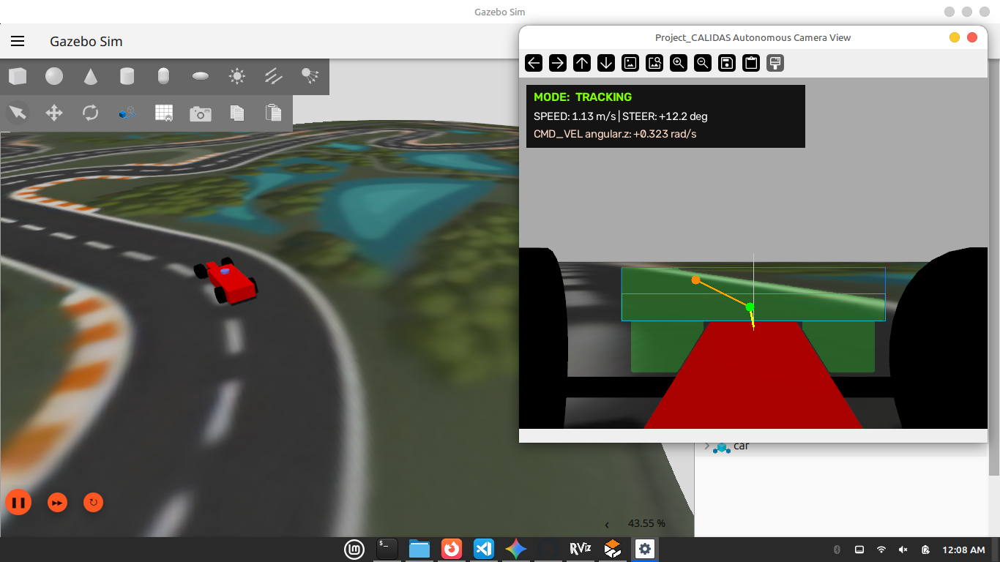

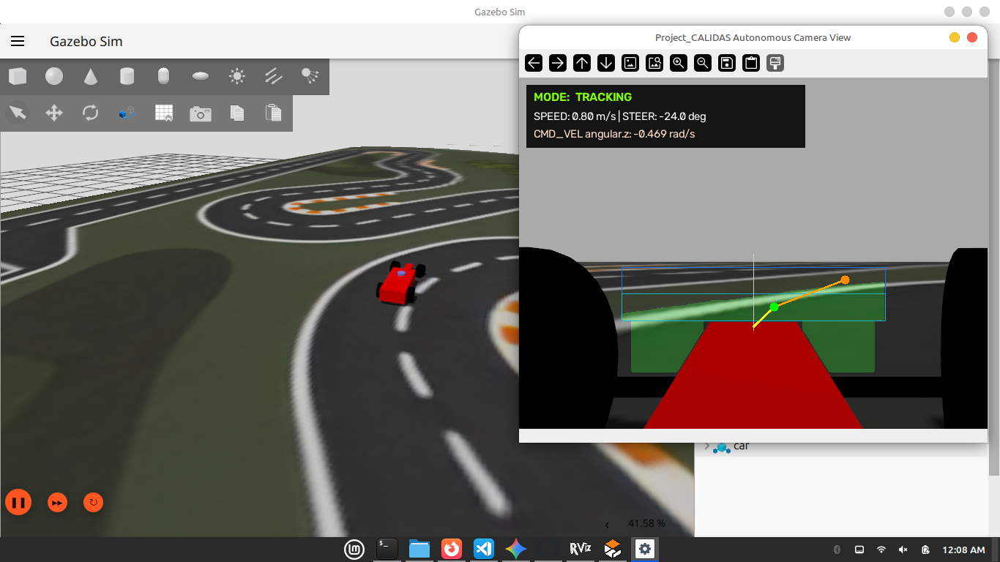

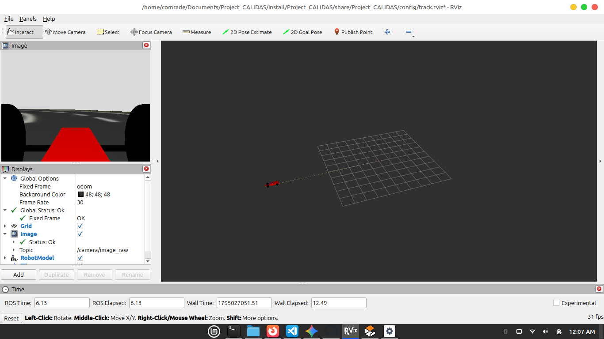

**Project - 2**

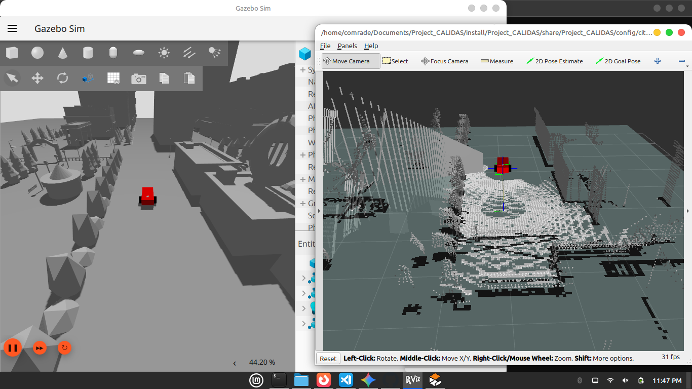

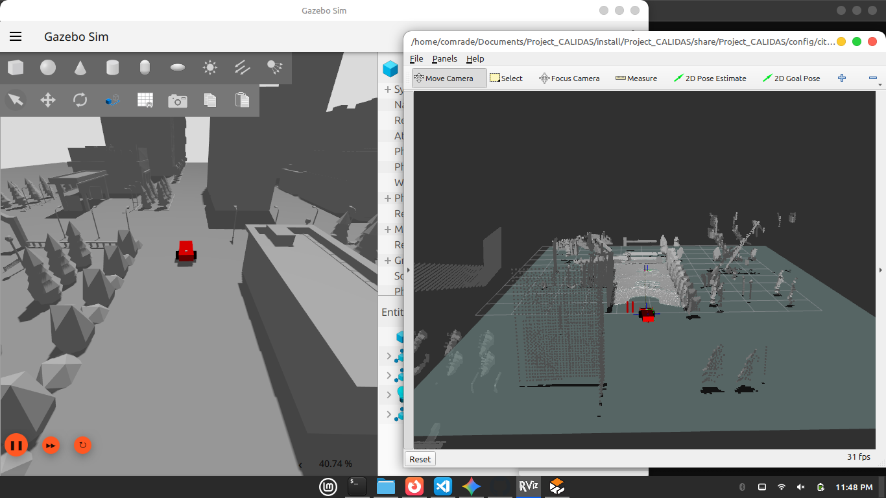

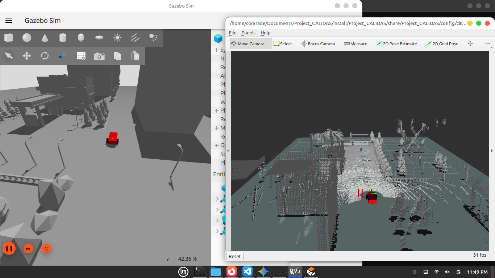

**Project - 3**

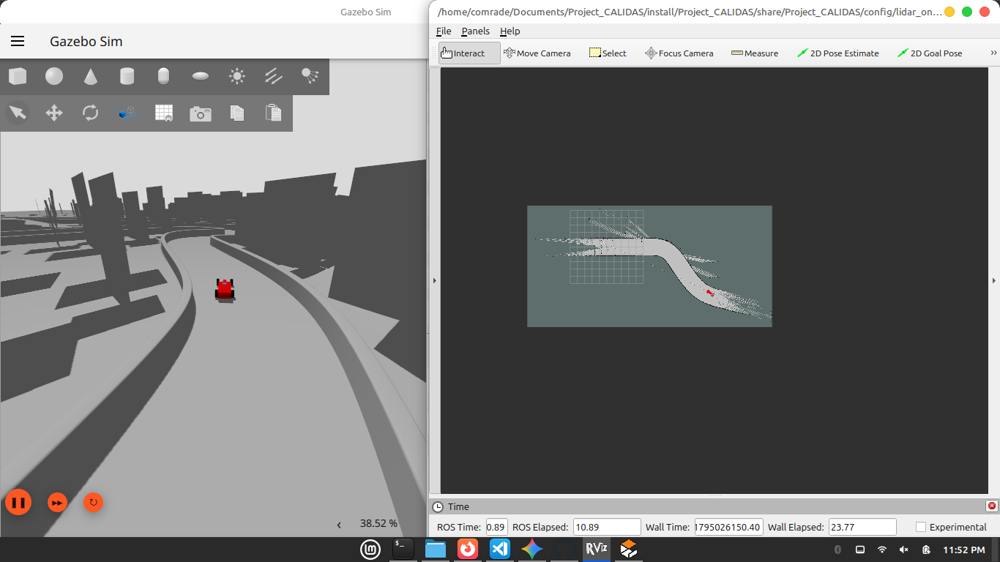

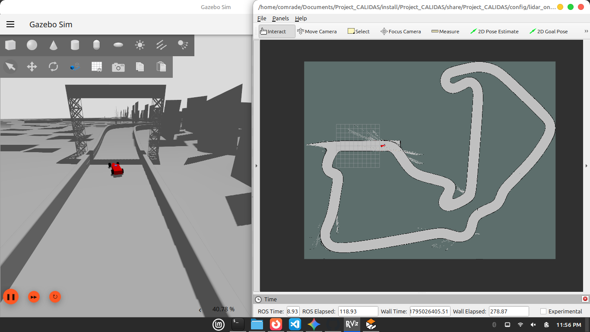

---

## Known limitations and roadmap

**Current limitations**

- **Reactive control.** The racer and explorer decide from what the sensors see right now; they do not plan a global racing line or a full exploration route.
- **Wheel odometry only.** Pose comes from the drive plugins. Long runs will drift; there is no IMU or sensor fusion yet.
- **Flat-world LiDAR.** A 2D LiDAR reads steep ramps in the 3D Silverstone mesh as walls, which can disturb the map and Nav2 on slopes.
- **Absolute paths in the world files.** See the `sed` step in [Build](#build).
- **Speed.** On mid-range hardware the simulator runs below real time, so sensor rates are lower than configured.

**Roadmap**

- [ ] Inverse perspective mapping and curvature feed-forward for the camera car
- [ ] Stanley or pure-pursuit path tracking on a recorded racing line
- [ ] IMU and `robot_localization` EKF fusion
- [ ] Portable asset paths through `GZ_SIM_RESOURCE_PATH`
- [ ] Frontier-based exploration for the depth robot

---

## Credits, assets and license

**Code** is released under the [Apache License 2.0](src/Project_CALIDAS/LICENSE).

**Third-party assets** (scaled, converted and placed in the worlds by this project):

| Asset | Source | Author | License |
|---|---|---|---|
| `src/silverstone.obj` — *Mini Silverstone* | [Sketchfab](https://skfb.ly/oLnzJ) | Dylan Jade | [CC BY 4.0](https://creativecommons.org/licenses/by/4.0/) |
| `src/city.obj` — *low poly city* | [Sketchfab](https://skfb.ly/6R9r7) | Boris731 (vdv77) | [CC BY 4.0](https://creativecommons.org/licenses/by/4.0/) |
| `src/track.png` — top-down race circuit | [Pinterest](https://pin.it/49lUIDZRW) | original illustrator unknown | used for non-commercial study and simulation only |

**Acknowledgements.** The simulation approach was inspired by the [Articulated Robotics](https://articulatedrobotics.xyz) tutorials, adapted here to Gazebo Harmonic and ROS 2 Jazzy.

<div align="center">

**Built by [Balaji VM](https://github.com/balaji-vm-official)**

</div>
